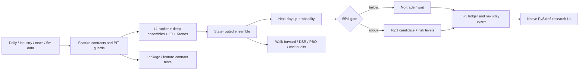
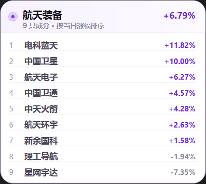

# Falsification-First Quant Research

**基于小样本与严格风控的 A 股量化策略证伪与复盘工具**

[English](#english) · [中文](#中文) · [For reviewers](docs/FOR_REVIEWERS.md)

> A native desktop research workstation that treats **disproving a strategy** as a first-class outcome.
>
> 一个把“证伪”当作成果的原生量化研究工具。


*A screenshot from the author's local research run. It is a UI demonstration, not an investment recommendation.*

## At a glance

- **Native PySide6 desktop application** — no browser shell, no Edge app mode, no automatic order routing.
- **End-to-end A-share research pipeline**: data ingestion → feature contracts → model ensemble → probability gate → T+1 ledger → next-day review.
- **Evidence over storytelling**: purged walk-forward, negative controls, cost stress, DSR/PBO diagnostics, bootstrap intervals and minimum detectable effects.
- **A deliberately negative result**: the compact model did **not** show a robust after-cost edge. That result is kept and documented instead of hidden.
- **Engineering under constraints**: runs on a single RTX 4060; the daily pipeline is roughly 10–16 minutes; no paid market-data subscription is required.

## The research question

> Can a compact, resource-constrained ensemble rank next-day A-share winners well enough to survive realistic execution and transaction costs?

**Current answer: not demonstrated.** The project is therefore framed as a research and engineering artifact, not a profitable trading system.

The important distinction is:

- A **backtest with a positive arithmetic mean** is not an investable edge.
- A **negative result under realistic costs** is still a valid research contribution if the experiment was designed, pre-registered, and audited properly.

## Why this repository exists

Most public “quant” repositories optimize for an attractive equity curve. This one optimizes for a defensible process:

1. **Falsification first.** Each new branch has a written hypothesis, acceptance criteria, and a stop rule.
2. **Leakage and PIT discipline.** Feature availability is part of the contract; future-data injection tests fail closed.
3. **Costs are part of the label.** T+1 execution, turnover, fees and slippage are modeled before a strategy is called promising.
4. **Small samples are treated as small.** Effective sample size, confidence intervals and minimum detectable effects are reported, not ignored.
5. **Negative results stay in the record.** Failed branches are not quietly retuned until something looks good.
6. **The system is shipped.** Data, models, reports, ledger and a native desktop UI are integrated, not left as a notebook.

### Reviewer note

For a research-engineering or data-engineering review, the value of this repository is the combination of:

- **systems engineering** (native UI, async data feed, cache fallback, failure recovery, resource bounds),
- **applied ML** (ensemble routing, probability ranking, calibration and OOS diagnostics),
- **research integrity** (pre-registration, leakage tests, cost stress, multiple-comparison awareness, publishable negative results),
- **communication** (bilingual documentation, explicit limitations, reproducible commands).

This is **not** a claim of alpha. It is a claim of process: the author can build a complete research system and stop when the evidence says stop. See [For Reviewers](docs/FOR_REVIEWERS.md) for a 60-second guide.

## Evidence

### Long-window Top1 (19 purged folds, 742 out-of-sample days, 2023-09..2026-10)

| Assumption | Account path |
|---|---:|
| 14.5 bps/side | 1.011x |
| 25 bps/side | **0.463x** |
| 40 bps/side | **0.151x** |

- Maximum cohort drawdown: **−80.2%**
- Daily volatility ≈6.4%; daily turnover ≈94%
- Effective independent observations ≈371 (2-day overlapping labels)
- Minimum detectable mean daily net return ≈0.829%/day — the sample is too small to certify a small edge
- Arithmetic net mean can look positive while geometric/account return is flat or negative; never quote arithmetic mean as annual return

### TOP1-AUDIT-002 (120 signal days, 2026-04-27..2026-10-23, T+1 open→T+2 close)

| Definition | Result |
|---|---:|
| Realizable 2-day net at 14.5 bps | +0.043% |
| 95% CI | [−1.153%, +1.302%] |
| p(≤0) | 0.477 |
| 25 bps stress | negative |
| Gated-day net | +0.379%, CI [−1.265%, +2.036%], p=0.329 |

### What was tested and rejected

- `MICRO-005-ENC-002`: compact encoder → no incremental value (`ENCODER_FAIL`)
- Industry-layer v4 / v4.1 / Experiment A → rejected
- Page top-K and portfolio expansion → not better than Top1 under the tested definitions
- Breadth overlay → data feasibility partial; exact limit price only a proxy; realtime breadth unavailable; kept as a 60-day shadow
- Calibration/conformal diagnostics → useful, not promoted without forward evidence

The full record is in [docs/RESEARCH_STATUS.md](docs/RESEARCH_STATUS.md).

## Architecture



The system deliberately separates **research**, **production snapshot**, and **execution discipline**. It has no broker integration and cannot place orders.

## Desktop application

- Native frameless PySide6 window, Dynamic-Island-style surfaces, 45fps ambient paint bus and 60fps interactions.
- Short-term conclusion, long-term conclusion, evidence, top-page candidates, SW level-2 industry board, review and run status.
- Hover member popup for industries; explicitly information-only, not a trading signal.
- Frozen prediction ledger, stale-data guards and a 55% no-trade rule.



## Quick start

```bash
python -m venv .venv
# Windows: .venv\Scripts\activate
pip install -r requirements.txt
copy config\watchlist.example.yaml config\watchlist.yaml
python -m src.data.fetch_baostock
python -m src.features.build
python -m src.report.run_full
pythonw run_gui.pyw
```

- Market data, model weights, the live ledger and run logs are **not included**.
- GPU is optional; without it, the Kronos member is skipped and the rest of the pipeline degrades gracefully.
- The full pipeline takes roughly 10–16 minutes on the author's RTX 4060.
- Windows setup and scheduled-task helpers are in [`scripts/`](scripts/).
- Tests: `pytest tests` — leakage, feature-contract and metric-definition checks, not proof of profitability.

## Repository map

```text
src/             data, features, models, evaluation, reports, PySide6 UI
config/          targets, SW industry map, example watchlist
docs/            design, data, execution and research status
tests/           leakage, feature-contract and metric-definition tests
scripts/         Windows setup / update / scheduler helpers
vendors/Kronos/  upstream source + license (no weights)
assets/          application icons
run_gui.pyw      native desktop entry
run_daily.pyw    daily silent update entry
```

## Limitations and non-claims

- Free data is not fully point-in-time; current SW classification is not historical PIT.
- Exact limit-up/down and realtime breadth are unavailable; only proxies are used.
- Delisted-stock coverage and suspension handling remain limited.
- Historical results embed survivorship, classification and execution assumptions.
- No broker API, order routing, live execution, or investment advice.
- **No demonstrated after-cost alpha.** Do not treat the UI output as a recommendation.

## Third-party and license

No license is granted for this repository by default. The Kronos source under `vendors/Kronos` retains its upstream license; see [vendors/Kronos/LICENSE](vendors/Kronos/LICENSE). Market data and model weights are not redistributed.

---

## English

This repository is a **falsification-first quantitative research workstation** for A-share short- and long-horizon decision support. It is intentionally not a profitability claim.

### What it does

- **Short sleeve**: rank the current top-20 gainers in a battery-industry pool by next-day up-probability and select Top1. The 55% gate is a no-trade rule, not a return guarantee.
- **Long sleeve**: track `000927` under a long-horizon framing; daily direction is informational only.
- **Research stack**: daily/industry/news/5-minute data, LightGBM, deep ensembles, MR20/REV5 and zero-shot Kronos; state-routed fixed weights.
- **Execution discipline**: T+1 accounting, cost stress, frozen ledger, next-day review, stale-data guards.
- **Native UI**: PySide6 desktop, no browser; SW level-2 industry board with hover member lists (information only).

### What is proven

The project proves that a compact model can be **built, integrated, audited, and falsified**. It does **not** prove a profitable after-cost strategy:

- 742 OOS days, Top1 account: 1.011x at 14.5 bps/side; **0.463x** at 25 bps; **0.151x** at 40 bps.
- Maximum cohort drawdown −80.2%; effective n≈371; MDE ≈0.829%/day.
- Last 120 days: realizable 2-day net at 14.5 bps +0.043%, 95% CI [−1.153%, +1.302%], p(≤0)=0.477.
- Several research branches failed and remain documented rather than retuned away.

### For reviewers

If you are evaluating this as a research-engineering portfolio, start with [docs/FOR_REVIEWERS.md](docs/FOR_REVIEWERS.md). The short version: this demonstrates end-to-end system building, leakage-aware ML, cost-aware evaluation, and the discipline to publish a negative result.

### Quick start

```bash
python -m venv .venv
pip install -r requirements.txt
copy config\watchlist.example.yaml config\watchlist.yaml
python -m src.data.fetch_baostock
python -m src.features.build
python -m src.report.run_full
pythonw run_gui.pyw
```

Data, model weights, live ledgers and logs are excluded. The pipeline takes about 10–16 minutes on an RTX 4060; GPU is optional.

### Non-claims

This is research/engineering work, not investment advice. There is no broker integration, no order routing, and no demonstrated after-cost alpha. Historical metrics are not promises of future returns.
