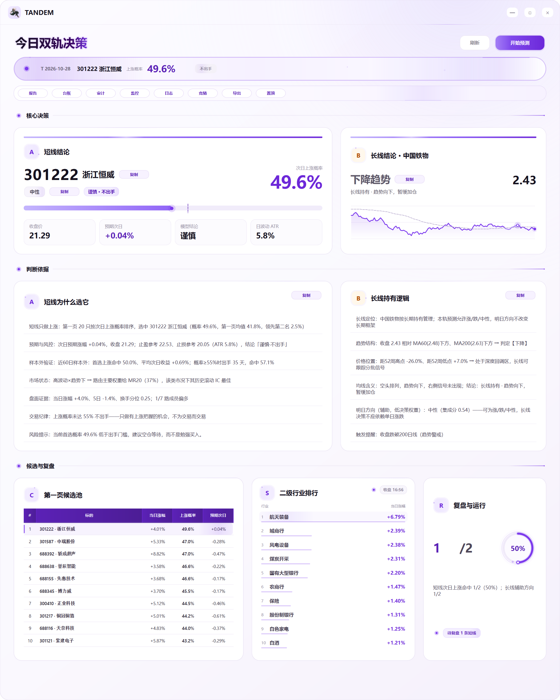

# TANDEM · A 股双轨研究台

[中文](#中文) · [English](#english)

> 一个本地优先的 A 股短线 / 长线研究原型。**它不是交易系统，不承诺收益，也不构成投资建议。**



*界面截图使用作者本地研究数据，仅用于展示交互与信息组织，不构成任何推荐。*

---

## 中文

### 这是什么

TANDEM 是一个运行在 Windows 桌面上的原生研究工具。它把“短线只做上涨、长线按长期持有管理”的规则做成一个可审计的每日流程：

- **短线轨**：在电池行业池中，从当日涨幅第一页（默认 20 只）按次日上涨概率选 Top1；概率低于 **55%** 时不出手。
- **长线轨**：固定观察中国铁物 `000927`，允许上涨 / 下跌 / 中性；单日方向只作辅助，不改变长期框架。
- **数据与模型**：日线、行业、新闻/情绪与 5 分钟研究缓存；LightGBM 排序/回归、深度模型多种子、MR20/REV5、Kronos 零样本，按市场状态路由固定权重。
- **执行纪律**：T+1 口径、成本压力、可交易性审计、冻结台账、次日复盘。
- **桌面界面**：PySide6 原生窗口，无浏览器；包含短线/长线结论、依据、候选池、申万二级行业榜、复盘与运行状态。
- **行业信息层**：申万二级行业实时排行 + 悬停成分股；仅信息展示，不接入短线打分或交易信号。

### 研究状态（客观）

这不是一个已经被证明能赚钱的策略。相反，仓库保留了失败和负面结果：

| 口径 | 结果 |
|---|---|
| 742 个样本外交易日，Top1 账户，14.5bps/边 | 1.011x |
| 同上，25bps/边 | 0.463x |
| 同上，40bps/边 | 0.151x |
| 同窗口最大回撤 | -80.2% |
| 近 120 日 Top1，扣 14.5bps 后 2 日净收益 | +0.043%，95% CI [-1.153%, +1.302%]，p(≤0)=0.477 |
| 近 120 日门槛日净收益 | +0.379%，95% CI [-1.265%, +2.036%]，p=0.329 |

结论：**成本后优势没有被证明，25bps 压力下历史账户为负。** 55% 门槛是风险纪律，不是收益保证。ENC-002/行业层/页内 top-K 等研究方向均未通过；breadth 仅在 60 日影子观察中。详见 [research status](docs/RESEARCH_STATUS.md)。

### 快速开始

```bash
python -m venv .venv
# Windows: .venv\Scripts\activate
pip install -r requirements.txt
copy config\watchlist.example.yaml config\watchlist.yaml   # 按自己的研究需要修改
python -m src.data.fetch_baostock
python -m src.features.build
python -m src.report.run_full
pythonw run_gui.pyw
```

数据、模型权重、运行日志、预测台账和截图来源数据**不包含在仓库中**。完整管线在作者的 RTX 4060 上约 10–16 分钟；没有 GPU 时可以跳过 Kronos（代码会优雅降级）。Kronos 权重需要按上游项目自行获取，仓库只包含其源码与许可证。

### 目录

```
src/            数据、特征、模型、评估、报告与 PySide6 界面
config/         目标、申万行业映射、示例自选股
docs/           设计、数据方案、执行手册与研究状态
tests/          防泄漏、特征契约、指标口径测试
scripts/        Windows 安装、更新与计划任务脚本
vendors/Kronos/ Kronos 上游源码与许可证（不含权重）
assets/         应用图标
run_gui.pyw     桌面入口
run_daily.pyw   每日静默更新入口（计划任务）
```

### 重要限制

- 免费数据源存在分类非 PIT、涨跌停只能做代理、实时 breadth 不可用等限制；行业卡片和个股排行都不能替代真实交易数据。
- 历史结果包含幸存者/分类/执行假设；不要把它当作未来收益承诺。
- 不包含任何券商接口、自动下单或实盘执行代码。
- 本项目是研究/工程展示，不是投资顾问服务。

### 测试

```bash
pytest tests
```

测试覆盖特征时点契约、未来数据泄漏、指标定义等；它们验证代码约束，不证明策略收益。

---

## English

### What it is

TANDEM is a native Windows desktop research workstation for A-share short-term and long-term decision support. It is a **research prototype, not a trading system, and not investment advice**.

- **Short sleeve**: within a battery-industry pool, rank the current top-20 gainers by next-day up-probability and select Top1. If probability is below **55%**, the rule is to stay out.
- **Long sleeve**: track `000927` (China Railway Materials) under a long-horizon framing; daily direction is informational only.
- **Data/model**: daily bars, industry indices, news/sentiment and 5-minute research caches; LightGBM, deep ensembles, MR20/REV5, and zero-shot Kronos with state-routed fixed weights.
- **Execution discipline**: T+1 accounting, cost stress, tradability checks, frozen prediction ledger, next-day review.
- **Native PySide6 UI**: no browser shell; short/long conclusions, evidence, candidate pool, SW level-2 industry board, review and run status.
- **Industry information layer**: SW level-2 realtime ranking with hover member lists. Information only; it does not alter stock scoring, the 55% gate, or production outputs.

### Research status (honest)

This is not a proven profitable strategy. Negative and failed results are kept in the repository:

| Definition | Result |
|---|---|
| 742 out-of-sample days, Top1 account, 14.5 bps/side | 1.011x |
| Same, 25 bps/side | 0.463x |
| Same, 40 bps/side | 0.151x |
| Max drawdown in that window | -80.2% |
| Last 120 days, Top1, 2-day net at 14.5 bps | +0.043%, 95% CI [-1.153%, +1.302%], p(≤0)=0.477 |
| Last 120 days, gated days net | +0.379%, 95% CI [-1.265%, +2.036%], p=0.329 |

**There is no demonstrated after-cost edge; the 25 bps account is negative historically.** The 55% gate is a risk discipline, not a return guarantee. ENC-002, industry-layer variants, and page top-K research failed; breadth remains a 60-day shadow. See [research status](docs/RESEARCH_STATUS.md).

### Quick start

```bash
python -m venv .venv
pip install -r requirements.txt
copy config\watchlist.example.yaml config\watchlist.yaml
python -m src.data.fetch_baostock
python -m src.features.build
python -m src.report.run_full
pythonw run_gui.pyw
```

Data snapshots, model weights, ledgers, run logs, and source data are **not included**. The full pipeline takes roughly 10–16 minutes on the author's RTX 4060; without a GPU, Kronos degrades gracefully. Kronos weights must be obtained separately; only its source and license are vendored.

### Repository layout

```
src/            data, features, models, evaluation, reports, PySide6 UI
config/         targets, SW industry map, example watchlist
docs/           design, data, execution and research status
tests/          leakage, feature-contract and metric-definition tests
scripts/        Windows setup/update/scheduler scripts
vendors/Kronos/ upstream source + license (no weights)
assets/         application icons
run_gui.pyw     desktop entry
run_daily.pyw   daily silent update entry
```

### Limitations

- Free data sources are not fully point-in-time; exact limit-up/down and realtime breadth are unavailable. Industry boards are informational, not trading data.
- Historical results embed survivorship, classification and execution assumptions. They are not a promise of future returns.
- No broker integration, order routing, or live execution is included.
- Research/engineering artifact only; not an investment advisory service.

### Tests

```bash
pytest tests
```

The tests cover feature availability contracts, look-ahead leakage and metric definitions. They validate engineering constraints, not profitability.

---

## License / third-party

No license is granted for this repository by default. Kronos source under `vendors/Kronos` retains its upstream license; see [vendors/Kronos/LICENSE](vendors/Kronos/LICENSE). Market data and model weights are not redistributed.
